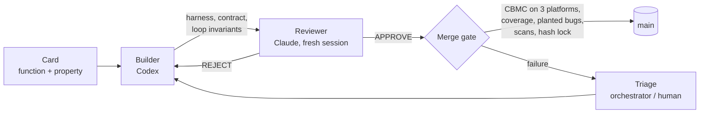

# proving-sqlite

**Can AI agents produce machine-checked proofs about real, heavily used C code, and can those proofs be trusted?**

This project tries it on SQLite, which may be the most widely deployed software library in the world. The target is the code that decodes SQLite's on-disk records. The goal is a proof that, for *any* bytes it is given, this code never does anything the C language leaves undefined. Proofs are written by one AI agent and reviewed by another from a different vendor. They are accepted only when a mechanical checker, the model checker [CBMC](https://github.com/diffblue/cbmc), verifies them. Throughout, SQLite's source stays exactly as published.

**Where it stands:**
- **Proved:** 18 of the 22 functions in scope are free of undefined behavior, on three platform configurations, together with two correctness properties.
- **Still open:** the remaining four functions (record comparison).
- **Bugs found in SQLite:** two, each with a reproducing test against unmodified SQLite 3.53.4.
- **Problems found in the verifier:** several in CBMC itself, including two places where it silently checked less than it appeared to.

---

## Contents

- [Background from first principles](#background-from-first-principles)
- [What exactly is proved](#what-exactly-is-proved)
- [How the work is organized](#how-the-work-is-organized)
- [Keeping the proofs honest](#keeping-the-proofs-honest)
- [What we found](#what-we-found)
- [Results](#results)
- [Limits and what is left](#limits-and-what-is-left)
- [Repository tour](#repository-tour)
- [Reproducing the proofs](#reproducing-the-proofs)

---

## Background from first principles

### Undefined behavior

The C standard leaves some operations *undefined*:
- reading or writing outside an object's memory;
- overflowing a signed integer;
- shifting by too many bits;
- dividing by zero, and a few dozen more.

When a program does one of these, the standard places no requirement at all on what happens next. Optimizing compilers assume these operations never occur and transform code accordingly. So undefined behavior is more than a crash risk: it is the root of many security vulnerabilities, and of bugs that appear only at certain optimization levels.

### Why this part of SQLite

SQLite stores each table row and index entry as a *record*: a compact byte string, with a header that describes the values that follow.
- **The header** is a sequence of *varints*. These are variable-length integers of 1 to 9 bytes, and each one gives a *serial type*: NULL, an integer of 1 to 8 bytes, a float, or a string or blob of some length.
- **The body** holds the values themselves, packed back to back.

The functions that decode varints, serial types and records run on bytes that come straight from a database file, and a database file can be corrupt or crafted by an attacker. So this is exactly the code where "safe for *any* input bytes" matters most. These functions also sit under every query, because index lookups compare records constantly.

### What a model checker proves

Testing runs a program on some inputs. A model checker such as CBMC instead translates the program, and the property to check, into a logic formula. It then uses a SAT solver to search *every* possible input at once. If the solver finds no input that breaks a check, the property holds for all inputs that meet the stated assumptions, not just the inputs someone thought to try.

To keep that tractable for a large program, each function gets a *contract*: what it **requires** of its inputs, what it **ensures** about its result, and what memory it **assigns**. Here is a real contract from this repository, for SQLite's 32-bit varint decoder:

```c
u8 contract_sqlite3GetVarint32(const unsigned char *p, u32 *v)
  __CPROVER_requires(__CPROVER_r_ok(p, 9))           // 9 readable bytes at p
  __CPROVER_requires(__CPROVER_w_ok(v, sizeof(*v)))  // room to write the result
  __CPROVER_assigns(*v)                              // writes nothing else
  __CPROVER_ensures(1 <= __CPROVER_return_value &&   // consumes 1..9 bytes
                    __CPROVER_return_value <= 9);
```

CBMC checks the function against its contract once. Wherever another function calls it, CBMC can then *replace* the call with the contract, so proofs compose upward from small functions to large ones.

A proof is driven by a *harness*: a small C function that creates arbitrary inputs satisfying the requirements and calls the function under proof. Loops need either a *loop invariant* (a fact true on every iteration, which CBMC also checks) or a fixed bound on how many times they run.

---

## What exactly is proved

The pinned code is SQLite 3.53.4 (source ID `bf7c7f30…c6f641c7b33e4e09459bcc`), checked byte for byte against [`pin.txt`](pin.txt). There are three properties ([`PROPERTIES.md`](PROPERTIES.md)):

| | Property | In one sentence |
|---|---|---|
| **P1** | No undefined behavior | Under its contract's requirements, each in-scope function triggers none of CBMC's undefined-behavior checks, meets its contract, and writes only what its contract allows. |
| **P2** | Varints round-trip | For every 64-bit value, writing it as a varint and reading it back gives the same value and length, and touches no other byte. |
| **P3** | Values decode as documented | For every serial type, the decoder produces the value that SQLite's published [file format](https://www.sqlite.org/fileformat2.html) says it should, checked against an independent reference decoder. |

**Two rules make P1 meaningful:**
- **A contract may never constrain the data bytes being decoded.** It can say how many bytes are readable, but not what they contain. A decoder whose reads depend on the data gets its worst-case footprint, which is why `sqlite3GetVarint32` above requires 9 readable bytes.
- **Every proof must pass on three platform configurations:** 64-bit little-endian, 32-bit little-endian, and 64-bit big-endian with unsigned `char`. Integer widths and byte order change which operations can overflow or misbehave.

The undefined behaviors that CBMC has no check for are argued case by case in [`UB-CLASSES.md`](UB-CLASSES.md) and are never called *proved*.

---

## How the work is organized

**The unit of work is a *card*:** one function or harness, one property, a token budget and a list of files the agent may change. There are 20 cards ([`cards/`](cards/)), which together cover the 22 functions.

| Role | Who | Job |
|---|---|---|
| **Builder** | Codex, GPT-6 Astra* | Writes the harness, the contract and any loop invariants, and runs the checker until the proof passes. |
| **Reviewer** | Claude Code, Opus 5.5 or Sonnet 5.5 | Judges the builder's proof in a fresh session. It sees only the artifacts, never the builder's reasoning, and it is always from the *other* vendor. |
| **Ledger agent** | Claude Code, Opus 5.5 | Takes every assumption a proof relies on about code outside its scope, and checks it against SQLite's real callers and test suite. |
| **Auditor** | Claude Code, Opus 5.5 | Independently checks every proposed change to the frozen rules before a human approves it. |
| **Orchestrator** | Claude Code, Opus 5.5 | Plans, triages failures, measures, and writes proposals. It never writes or fixes a proof. |
| **Human** | the project lead | Decides every change to the rules, every bound, and every finding. |

\* One card swapped vendors, with Claude building and Codex reviewing, after Codex's content filter stopped its first two builder rounds.

**The scheduler is [`tools/campaign.py`](tools/campaign.py), a plain program with no AI model in its loop.** It:
- starts sessions in isolated git worktrees;
- enforces token caps;
- commits each session's work;
- runs the gate;
- and is the only thing that ever commits to `main`.



---

## Keeping the proofs honest

A proof can be wrong in quiet ways: it can rest on an assumption that is never true, check nothing, or cover only some of the code. Most of this project's machinery exists to catch that. These are the techniques that mattered most.

1. **SQLite is never modified.** The proofs need annotations inside SQLite's source: loop invariants have to sit inside the loop. So the checker works on an *overlay*, a copy of `sqlite3.c` in which every addition is wrapped in a `PROOF(...)` span. [`tools/check_overlay.py`](tools/check_overlay.py) deletes every span and requires the result to equal the pinned upstream file byte for byte.
2. **Claims use four words, always precisely.**
   - **Proved:** the checker verified it.
   - **Tested:** runtime evidence.
   - **Assumed:** an entry in the assumption ledger, [`LEDGER.md`](LEDGER.md).
   - **Trusted:** listed in [`TRUSTED.md`](TRUSTED.md). That is CBMC itself, its model of C, and the preprocessor.

   Reports, results tables and commit messages all use this vocabulary.
3. **Every assumption is written down, then checked against reality.** Functions outside the scope, such as SQLite's memory allocator, get contracts recorded as numbered ledger entries. The ledger agent then reads and runs SQLite's actual callers to see whether each assumption holds. This is how one of the two bugs below was found.
4. **Vacuous proofs are caught two ways.** A proof whose assumptions contradict each other "verifies" everything, because no input satisfies them.
   - **Coverage:** CBMC must show that the proof reaches every line of the function, or the gap must be explained.
   - **Planted bugs:** [`proofs/MUTANTS`](proofs/MUTANTS) holds 65 hand-written bugs, such as an off-by-one or a wrong pointer step. Each one is applied to the code in turn, and the proof must *fail* on it. All 56 planted bugs for the finished cards are caught.
5. **Separation of duties.** Nobody reviews their own work. Builders and reviewers come from different vendors, and reviewers never see the builder's conversation. Before one merge, the orchestrator also planted a bug of its own in the code, to confirm that the approved proof caught it.
6. **The rules are frozen and hashed.** [`proof.lock`](proof.lock) holds SHA-256 hashes of the properties, the checker options, the platform definitions, the tools, the planted bugs and the agents' instructions, and the gate verifies them. Changing any of them takes a written proposal under [`evidence/approvals/`](evidence/approvals/), an independent audit, and a human's approval. A standing rule: *no one ever weakens a property, check or test to make a proof pass.*
7. **Mechanical scans of every harness.** [`tools/scan.py`](tools/scan.py) rejects harness patterns that could quietly narrow a proof: assumptions about data bytes, oversized buffers that hide out-of-bounds reads, unexplained constant inputs, and more.
8. **Bounded proofs are labelled and tested past their bounds.** Where the checker can't handle unbounded inputs in reasonable time, a proof is limited to stated bounds. "At most 4 fields and 256 bytes" is an example. The bound appears in every result line that cites the proof, and native tests exercise the real compiled code beyond it.

---

## What we found

### Two bugs in SQLite 3.53.4

Both are reproduced natively against the unmodified source, with tests in [`tests/repro/`](tests/repro/). Details are in [`FINDINGS.md`](FINDINGS.md).

**F-001: negating a comparison result of `INT_MIN`.**
- **The code:** when SQLite compares index keys on a descending (`DESC`) column, it flips the sign of the comparison result with `rc = -rc`.
- **The input that breaks it:** for a column with a user-defined collation, that result comes from the application's comparison function. The API only asks for a negative, zero or positive value, so `INT_MIN` is a legal "less than". Negating `INT_MIN` overflows, which is undefined behavior.
- **What happens:** in compiled code the negation wraps back to `INT_MIN`, so the sign never flips. On an index declared `x COLLATE c DESC`, keys are ordered wrongly: queries return wrong results, and with 2,001 rows `PRAGMA integrity_check` reports 2,000 of them "missing from index".
- **How it was found:** a builder found it while proving the comparison function. A reviewer and an auditor then reproduced it independently, at `-O2` and `-O0`.

**F-002: reading past a buffer in the pre-update hook.**
- **The assumption:** the record decoder relies on its callers to provide a few bytes of padding after each record. The proof states this as ledger assumption A-001.
- **The violation:** when the ledger agent checked that assumption against every caller, it found that `sqlite3_preupdate_old` copies a stored record into a buffer of exactly the record's size, with no padding.
- **The consequence:** a corrupt record in the database file makes the decoder read up to 7 bytes past the end of a heap allocation, which AddressSanitizer reports. This is reachable through the public API in builds with `SQLITE_ENABLE_PREUPDATE_HOOK`.

The bug sits in *how a proved function is called*, not in the function itself. Writing the assumption down as a ledger entry is what made it checkable.

### Problems in the verifier itself

A proof is only as good as the checker. Running CBMC 6.11 hard on real code turned up several problems in it, each recorded with a reproduction in [`evidence/orchestrator/tool-issues.md`](evidence/orchestrator/tool-issues.md).

- **Unsound in two places:**
  - *Flexible array members* (`struct { …; T a[]; }`) are bounds-checked only at an element's start, so a read that runs off the end partway through an element goes unflagged. The workaround: allocate such structs at their exact size, and write footprints in whole elements.
  - The *legacy* contract engine never checks that what a loop writes falls inside what its enclosing function is allowed to write. The project added its own textual check, and documents what that check can't see.
- **False alarms:** CBMC's conversion check rejects converting a float to exactly the most negative integer of the target type, which C permits. The check is now run in a narrower form, and the edge case is handled separately.
- **Performance cliffs and crashes:**
  - one encoding of contracts blows up when a loop advances a pointer while calling contract-replaced functions;
  - one solver option crashes outright;
  - unwinding a loop before measuring coverage reports lines as unreached that are in fact reached.

### Where the method reached its limits

**The record decoder** (`sqlite3VdbeRecordUnpack`) was proved only for records of at most 4 fields and 256 bytes.
- Larger bounds exhausted memory or the 10-minute limit, under every solver configuration tried.
- The bound is approved, labelled, and tested natively beyond its limits.
- A later measurement found a different encoding that drops the byte limit. That replacement is planned.

**The record comparison function** (`sqlite3VdbeRecordCompareWithSkip`) is where F-001 lives. It needed a new tool pass, a narrowly scoped exception for F-001's known failure, and an approved bound of 8 fields. Its proofs were not finished within the milestone's budget.

---

## Results

As of November 2026: 16 of 20 cards merged, 23 proofs, each passing on all three platforms. The last full gate passed with 0 failures in 6,030 seconds. The full per-proof table, with CBMC times, coverage and planted-bug counts, is in [`RESULTS.md`](RESULTS.md).

| Card | Function(s) | Property | Status |
|---|---|---|---|
| C-01 | `sqlite3PutVarint`, `putVarint64` | P1 | proved |
| C-02 | varint round trip | P2 | proved |
| C-03 | `sqlite3GetVarint` | P1 | proved |
| C-04 | `sqlite3GetVarint32` | P1 | proved |
| C-05 | `sqlite3VarintLen` | P1 | proved |
| C-06 | `sqlite3VdbeSerialTypeLen`, `sqlite3VdbeOneByteSerialTypeLen` | P1 | proved |
| C-07 | `serialGet`, `serialGet7` | P1 | proved |
| C-08 | `sqlite3VdbeSerialGet` | P1 | proved |
| C-09 | serial-value decoding vs. the file format | P3 | proved |
| C-10 | `vdbeRecordDecodeInt` | P1 | proved |
| C-11 | `sqlite3IsNaN`, `sqlite3IntFloatCompare` | P1 | proved |
| C-12 | `isAllZero` | P1 | proved |
| C-13 | `sqlite3VdbeMemSetNull` | P1 | proved |
| C-14 | `sqlite3VdbeAllocUnpackedRecord` | P1 | proved |
| C-15 | `sqlite3VdbeRecordUnpack` | P1 | proved, bounded: ≤ 4 fields, ≤ 256 bytes |
| C-16 | `sqlite3VdbeFindCompare` | P1 | proved |
| C-17 | `sqlite3VdbeRecordCompareWithSkip` | P1 | open (F-001 lives here) |
| C-18 | `sqlite3VdbeRecordCompare` | P1 | open, needs C-17 |
| C-19 | `vdbeRecordCompareString` | P1 | open, needs C-17 |
| C-20 | `vdbeRecordCompareInt` | P1 | open, needs C-17 |

**By the numbers:**
- about 24,600 individual CBMC checks across the merged proofs and platforms;
- 7 recorded assumptions about code outside the scope;
- 18 verifier and tooling issues logged;
- about 856 million tokens across all agent sessions (most of them cached context), within a 1-billion-token budget.

---

## Limits and what is left

- **The four record-comparison cards (C-17 to C-20)** are designed and partly measured, but not proved.
- **Every result rests on the trusted base:** CBMC 6.11.0, its model of C and of the standard library, and the compiler's preprocessor ([`TRUSTED.md`](TRUSTED.md)). The verifier problems above show why that list is stated explicitly.
- **"No undefined behavior" holds under each function's contract.** Callers must meet the requirements, and F-002 is a case where one does not.
- **The scope is 22 functions,** a small, security-relevant slice of SQLite, not the whole library.

---

## Repository tour

| Path | What it holds |
|---|---|
| [`PROPERTIES.md`](PROPERTIES.md) | the three properties, exactly as proved |
| [`RESULTS.md`](RESULTS.md), `results.csv` | every proof on every platform (generated) |
| [`FINDINGS.md`](FINDINGS.md), [`tests/repro/`](tests/repro/) | the SQLite bugs and their reproducing programs |
| [`LEDGER.md`](LEDGER.md) | every assumption about out-of-scope code, and its status |
| [`TRUSTED.md`](TRUSTED.md), [`UB-CLASSES.md`](UB-CLASSES.md) | what is trusted, and how each kind of undefined behavior is handled |
| `upstream/`, [`pin.txt`](pin.txt) | the pinned SQLite source, hashed |
| `overlay/sqlite3.c` | upstream plus `PROOF(...)` annotations, and nothing else |
| `proofs/C-NN/` | each card's harness, build description and notes |
| `proofs/contracts/` | one contract per function |
| `proofs/CHECKS`, `proofs/CONFIGS`, `proofs/MUTANTS` | checker options, platform definitions, planted bugs |
| [`tools/`](tools/) | `prove.py` (build and check), `mutate.py`, `scan.py`, `gate.py`, `lock.py`, `campaign.py` (the scheduler) |
| `agents/` | the instructions each agent role works from |
| `cards/` | the 20 work items |
| `reviews/`, `reports/` | every reviewer verdict and builder report |
| `evidence/` | gate logs, approval records, measurements, tool-issue reproductions |

---

## Reproducing the proofs

**Requirements:**
- Linux;
- CBMC 6.11.0;
- gcc with `gcc-multilib`, for the 32-bit configuration;
- Python 3.

**Commands:**

```sh
# One card's gate: hash lock, overlay check, scans, proofs on all three platforms,
# coverage and planted bugs (it also re-proves cards that depend on it)
make gate CARD=C-04

# A single card's proofs, or its coverage
python3 tools/prove.py prove    --card-dir proofs/C-04
python3 tools/prove.py coverage --card-dir proofs/C-04

# Reproduce a finding natively (see FINDINGS.md for the exact command and controls)
ls tests/repro/
```

A full gate over every merged card takes one to two hours on a 24-core machine.

---

## License

No license has been chosen yet.
